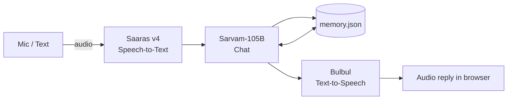

# E-Bhai — a voice-first study buddy

> Talk to it, think out loud, and it remembers. E-Bhai is one app that merges three ideas into a single voice-first experience: a **daily voice check-in friend**, a **spoken-reasoning doubt solver**, and a **voice journal that narrates your own memoir**. It runs on [Sarvam AI](https://docs.sarvam.ai/) models built for Indian languages and code-mixed speech.

**Live demo:** `<https://e-bhai-sarvamai2k26-ug1.streamlit.app/>`
**Repo:** `https://github.com/Athmanthe1/E-Bhai`

---

## Why E-Bhai?

Studying alone is lonely, and most tutoring tools hand you the answer instead of finding out *why* you got it wrong. Most journaling and wellness apps need typing and logging.

E-Bhai flips this:

- You **speak** (in English, Hindi or Hinglish), the way you actually talk.
- It **listens to your reasoning**, not just your question.
- It **remembers** across tabs. Your doubts, your mood and your journal feed each other, so the check-in can ask about the topic you struggled with yesterday.

That shared memory is what turns three separate ideas into one product.

---

## The three ideas, merged

| Idea (from the build idea bank) | Track | In E-Bhai |
|---|---|---|
| Elder Companion Agent (daily voice check-ins) | Conversation | **Check-in** tab: a warm, informal, funny voice friend that checks mood, sleep and what's due |
| Bhasha Doubt Solver | Sarvam-105B | **Doubt** tab: you explain your thinking, it detects the misconception and gives a hint before the answer |
| Voice Journal Narrator | Creatives | **Journal** tab: your entries become a spoken "audio memoir" recap |

---

## Features

### 1. Check-in
- Record your voice, get a spoken reply
- Informal, short, funny, with one concrete nudge per reply
- Uses stored memory (recent check-ins, weak topics, recent journal entries) so replies feel personal
- Saves a mood and a one-line summary after each check-in

### 2. Doubt (spoken-reasoning misconception detector)
- Pick a course: Abstract Algebra, Real Analysis or C Programming
- The app first asks you to **explain your thinking** (typed or spoken)
- A model call returns a strict JSON diagnosis: misconception, topic, severity, a Socratic hint, an analogy and a practice question
- The hint is shown first; the full explanation is behind a "Reveal" button
- Every diagnosed error is logged and updates a per-topic **mastery score (0–100)**, shown as a bar chart

### 3. Journal
- Add daily entries by typing or speaking
- One click generates a ~150-word first-person spoken recap of your recent entries
- Plays in the app and can be downloaded as audio

### Shared
- Language selector: English, Hindi, Hinglish
- Memory export and import from the sidebar (so progress survives hosting restarts)
- Friendly error handling: a failed API call shows a short message, never a traceback

---

## How it works



1. **Hear**: Saaras v4 transcribes your speech. Hinglish uses `codemix` mode.
2. **Think**: Sarvam-105B writes the reply or returns structured JSON for the doubt diagnosis. `build_context()` injects a compact summary of your memory.
3. **Speak**: Bulbul turns the reply into audio. Long text is split at sentence boundaries before synthesis.
4. **Remember**: results are written to `memory.json` (atomic writes; a corrupt or missing file resets safely).

### Sarvam APIs used

| Capability | Model | Used for |
|---|---|---|
| Speech-to-text | `saaras:v4` | Transcribing voice in Hindi, English and code-mixed speech |
| Chat completion | `sarvam-105b` | Check-in replies, misconception diagnosis, memoir writing |
| Text-to-speech | `bulbul:v4-flash` | Spoken replies, hints and the audio memoir |
| Translation | Sarvam Translate | Available in `sarvam_core.py` for translating replies |

---

## Project structure

```
.
├── app.py              # Streamlit UI: sidebar + 3 tabs
├── sarvam_core.py      # Thin wrappers: chat, stt, tts, translate (all error-safe)
├── memory.py           # JSON memory store + build_context()
├── smoke_test.py       # Chat -> TTS -> STT round trip against the live API
├── tests/              # Unit tests for pure helpers (JSON extraction, memory)
├── requirements.txt
├── .gitignore
└── README.md
```

---

## Getting started

### Prerequisites
- Python 3.10+
- A Sarvam API key from the [Sarvam dashboard](https://dashboard.sarvam.ai)

### Install

```bash
git clone https://github.com/<your-username>/<your-repo>.git
cd <your-repo>
pip install -r requirements.txt
```

### Add your API key

Pick one:

```bash
# Option A: environment variable
export SARVAM_API_KEY="your_key"          # macOS / Linux
# $env:SARVAM_API_KEY="your_key"          # Windows PowerShell
```

```toml
# Option B: .streamlit/secrets.toml (gitignored)
SARVAM_API_KEY = "your_key"
```

> Never commit your key. `.streamlit/secrets.toml` and `.env` are in `.gitignore`.

### Verify Sarvam works

```bash
python smoke_test.py
```

You should see a chat reply, a saved `out.wav`, and a transcript of that audio.

### Run

```bash
streamlit run app.py
```

**In GitHub Codespaces**, uploads (including mic recordings) can return a 403 through the forwarded port. Use:

```bash
streamlit run app.py --server.headless true --server.enableCORS false --server.enableXsrfProtection false
```

Then open the forwarded port in your browser and allow microphone access. Use these flags only for Codespaces development.

### Run the tests

```bash
pytest
```

---

## Deploying

### Streamlit Community Cloud (recommended)

1. Push the repo to GitHub.
2. Go to [share.streamlit.io](https://share.streamlit.io) and click **New app**.
3. Select the repo, the `main` branch and `app.py`.
4. Under **Advanced settings → Secrets**, add:
   ```
   SARVAM_API_KEY = "your_key"
   ```
5. Deploy, then test on your phone.

> The hosting filesystem is ephemeral, so `memory.json` can reset when the app restarts. Use the sidebar **Export / Import memory** buttons to keep your progress.

---

## 60-second demo script

1. **Check-in (20s):** Record "Aaj thoda tired hu, quiz hai kal." E-Bhai replies in voice with a joke and a nudge.
2. **Doubt (25s):** Pick *Abstract Algebra*, explain out loud why you think a subset is a subgroup. E-Bhai finds the misconception, gives a hint (not the answer), and your mastery bar moves.
3. **Memory (10s):** Return to Check-in. E-Bhai now references the topic you just struggled with.
4. **Journal (5s):** Generate the audio memoir and play it.

---

## Design notes

- **Error-safe by default.** Every API call and file operation is wrapped so the UI degrades gracefully instead of crashing.
- **Hints before answers.** The doubt flow is designed to push the learner to reason first, then reveal the full explanation on request.
- **Structured output handled defensively.** Model replies may include extra text around JSON, so the app extracts the first JSON block and falls back to a plain explanation if parsing fails.
- **Secrets stay out of git.** Keys come from the environment or Streamlit secrets only.

---

## Limitations

- Mic input needs a browser with microphone permission over HTTPS (hosted URLs and Codespaces forwarded ports qualify).
- Language options in the UI are English, Hindi and Hinglish. Sarvam supports many more Indian languages, which would be a straightforward extension.
- The mastery score is a simple heuristic (decreases on a diagnosed misconception, increases when you mark "got it"), not a calibrated learner model.
- Memory is a single local JSON file, not a database, so it is per-deployment rather than per-user.
- This is a hackathon build. The diagnosis quality depends on the model and is not a substitute for a teacher.

---

## Roadmap

- More Indian languages in the language selector
- Proactive reminders (due dates, quiz prep) driven by memory
- Per-user accounts with a real database
- Spaced-repetition practice built from logged misconceptions
- A voice avatar and an offline emergency mode

---

## Built with

- [Sarvam AI](https://docs.sarvam.ai/): Saaras v4, Sarvam-105B, Bulbul
- [Streamlit](https://streamlit.io/)
- Python

---

## License

MIT, or your choice. Add a `LICENSE` file before publishing.

## Authors

Built in a 1-hour build-a-thon by `<your name / team>`.